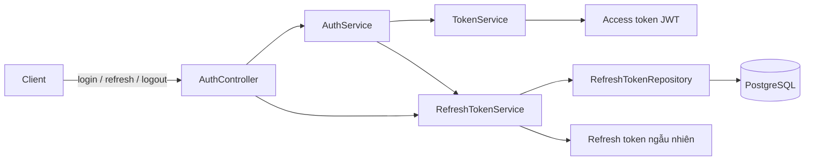
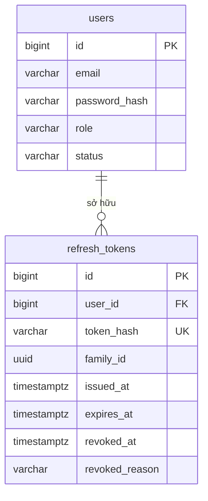
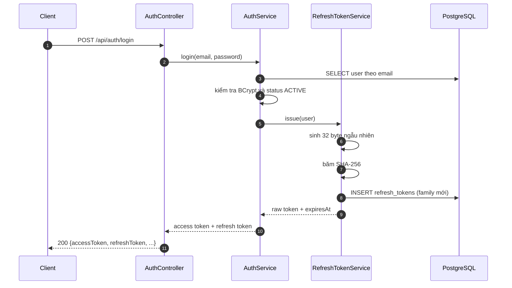
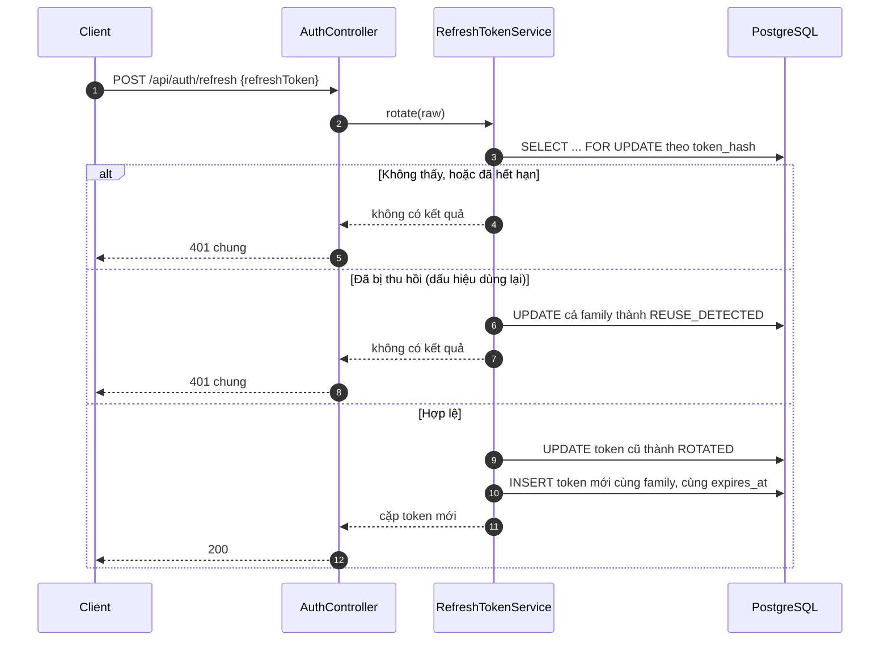
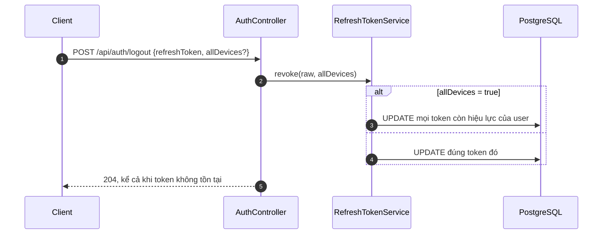
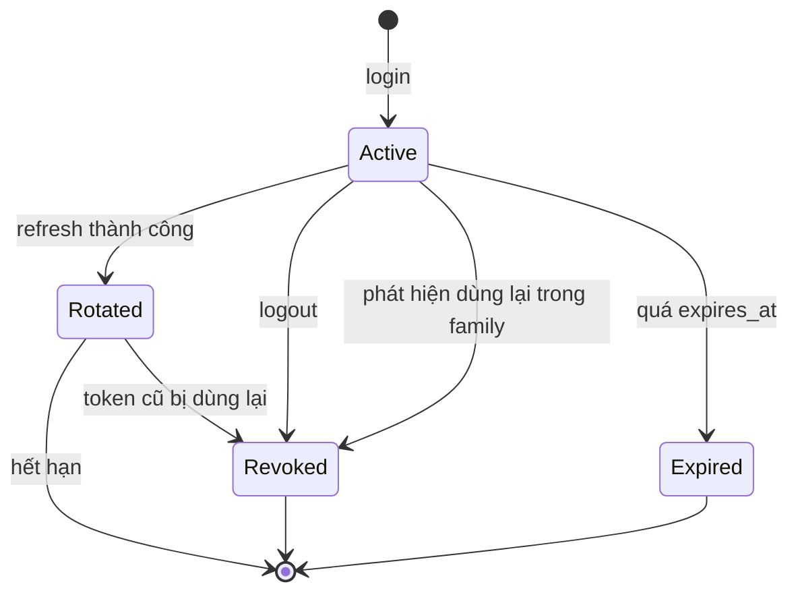

# Feature #4: Refresh token + logout

Tài liệu kế hoạch. Không phải code cuối cùng. Mục tiêu là để tự làm từng bước,
có sơ đồ và tiêu chí kiểm tra rõ ràng.

## 0. Mục tiêu

1. Access token ngắn hạn (1 giờ) vẫn như hiện tại.
2. Thêm refresh token dài hạn (30 ngày) để lấy access token mới mà không cần
   đăng nhập lại.
3. Refresh token **xoay vòng** mỗi lần dùng: token cũ bị thu hồi, token mới được
   cấp. Phát hiện dùng lại token cũ thì thu hồi cả phiên.
4. Có logout: thu hồi refresh token, tùy chọn thu hồi mọi thiết bị.
5. Xử lý được giới hạn L7: hiện chưa có refresh token và chưa thu hồi được token.

## 1. Hiện trạng trong code

| Thành phần | Hiện tại |
|---|---|
| `TokenService` | Cấp JWT HS256, TTL 1 giờ, claim `sub`, `email`, `role` |
| `AuthService.login` | `@Transactional(readOnly = true)`, trả `IssuedToken` |
| `TokenResponse` | `accessToken`, `tokenType`, `expiresIn` |
| `SecurityConfig` | `/api/auth/**` permitAll, stateless, Bearer header, CORS không credentials |
| `ClockConfig` | Có bean `Clock` theo giờ Việt Nam, nên dùng thay `Instant.now()` |
| Migration | Mới nhất là `V9__notifications.sql` |
| Tài liệu | `docs/business-rules.md` R61-R64, giới hạn L7 |

Hệ quả: access token hiện không thu hồi được. Logout nếu chỉ xóa token ở client
thì token vẫn dùng được tới khi hết hạn. Đây là lý do phải có refresh token và
một bảng trạng thái phía server.

## 2. Phạm vi

### Làm trong feature này

- Bảng `refresh_tokens`, entity, repository.
- Sinh, băm, xoay vòng, thu hồi refresh token.
- Endpoint `POST /api/auth/refresh` và `POST /api/auth/logout`.
- Login trả thêm refresh token.
- Cấu hình TTL, tài liệu, test.

### Không làm (để feature sau)

- Thu hồi access token đang còn hạn. Access token vẫn sống tới `exp`.
- Đổi mật khẩu, quên mật khẩu, xác minh email.
- Refresh token trong cookie httpOnly. Hiện tại API dùng Bearer + CORS không
  credentials, chuyển sang cookie sẽ kéo theo CSRF.
- Quản lý thiết bị, hiển thị danh sách phiên.
- Giới hạn tần suất riêng cho `/refresh`.
- Chuyển bộ đếm đăng nhập sang Redis.

## 3. Quyết định thiết kế

| Vấn đề | Lựa chọn | Khuyến nghị | Lý do |
|---|---|---|---|
| Refresh token là gì | JWT hay chuỗi ngẫu nhiên | **Chuỗi ngẫu nhiên 32 byte** | Cần thu hồi được, nên phải có trạng thái trong DB. JWT refresh cũng phải tra DB, lại dài và thừa |
| Lưu trong DB | Plaintext hay hash | **Hash SHA-256 dạng hex** | Lộ DB không lộ token. Token có 256 bit entropy nên SHA-256 đủ, không cần BCrypt |
| Vì sao không BCrypt | BCrypt có salt, không tra cứu theo index được | SHA-256 | Phải tìm token bằng `WHERE token_hash = ?`. BCrypt sẽ buộc quét toàn bảng |
| Xoay vòng | Có / không | **Có** | Token bị lộ chỉ dùng được một lần, và ta phát hiện được dấu hiệu bị đánh cắp |
| Nhóm token | Có `family_id` / không | **Có** | Một lần đăng nhập = một family. Phát hiện tái sử dụng thì thu hồi cả family, không ảnh hưởng thiết bị khác |
| Thời hạn refresh | Trượt 30 ngày hay tuyệt đối 30 ngày | **Tuyệt đối** | Token mới copy `expires_at` của token đầu family. Tránh phiên sống mãi nếu user hoạt động liên tục |
| Logout | Thu hồi refresh / thu hồi cả access | **Chỉ refresh** | Access token stateless, thu hồi từng cái sẽ phải thêm denylist. Ghi rõ giới hạn này |
| Truyền token | Body / cookie | **Body** | Giữ nguyên kiến trúc Bearer, không cần CSRF, hợp mobile |
| Nhiều thiết bị | Mỗi login một family | **Có** | Logout một máy không đá máy khác |
| Đua nhau refresh | Strict / grace window | **Strict, client single-flight** | Đơn giản, an toàn hơn. Grace 60 giây là tùy chọn nếu frontend hay gọi song song |

## 4. Sơ đồ

### 4.1 Thành phần



### 4.2 Mô hình dữ liệu



### 4.3 Đăng nhập



### 4.4 Refresh và xoay vòng



### 4.5 Logout



### 4.6 Vòng đời một token



## 5. Thiết kế database

Tạo `src/main/resources/db/migration/V10__refresh_tokens.sql`. Không sửa V2.

```sql
-- V10: refresh token xoay vòng, thu hồi được theo phiên (family).
CREATE TABLE refresh_tokens (
    id             BIGINT GENERATED ALWAYS AS IDENTITY PRIMARY KEY,
    user_id        BIGINT      NOT NULL REFERENCES users (id) ON DELETE CASCADE,
    token_hash     VARCHAR(64) NOT NULL,          -- hex SHA-256 của token gốc
    family_id      UUID        NOT NULL,          -- một lần đăng nhập = một family
    issued_at      TIMESTAMPTZ NOT NULL DEFAULT now(),
    expires_at     TIMESTAMPTZ NOT NULL,
    revoked_at     TIMESTAMPTZ,
    revoked_reason VARCHAR(30),
    CONSTRAINT ck_refresh_tokens_reason CHECK (
        revoked_reason IS NULL
        OR revoked_reason IN ('ROTATED', 'LOGOUT', 'LOGOUT_ALL', 'REUSE_DETECTED', 'USER_LOCKED')
    )
);

CREATE UNIQUE INDEX ux_refresh_tokens_hash ON refresh_tokens (token_hash);
CREATE INDEX ix_refresh_tokens_user ON refresh_tokens (user_id);
CREATE INDEX ix_refresh_tokens_family ON refresh_tokens (family_id);
CREATE INDEX ix_refresh_tokens_expires ON refresh_tokens (expires_at);
```

Ghi chú:

- `token_hash` là duy nhất nên tra cứu là index seek, không quét bảng.
- `family_id` không unique, vì một family có nhiều token theo thời gian.
- Index `expires_at` phục vụ job dọn dẹp (tùy chọn).
- `ON DELETE CASCADE`: xóa user thì token cũng mất.

## 6. API contract

### 6.1 Login (mở rộng, không phá vỡ client cũ)

```http
POST /api/auth/login
Content-Type: application/json

{"email":"a@b.com","password":"..."}
```

```json
{
  "accessToken": "eyJ...",
  "tokenType": "Bearer",
  "expiresIn": 3600,
  "refreshToken": "3xJ...",
  "refreshExpiresIn": 2592000
}
```

### 6.2 Refresh

```http
POST /api/auth/refresh
Content-Type: application/json

{"refreshToken":"3xJ..."}
```

- `200`: trả về **cùng cấu trúc** như login, cả access token mới và refresh token mới.
- `400`: thiếu hoặc rỗng `refreshToken`.
- `401`: token không tồn tại, hết hạn, đã thu hồi, bị dùng lại, hoặc user bị khóa.
  Tất cả trả **cùng một thông báo** để không lộ lý do.

### 6.3 Logout

```http
POST /api/auth/logout
Content-Type: application/json

{"refreshToken":"3xJ...","allDevices":false}
```

- `204`: luôn trả 204, kể cả token không tồn tại. Như vậy không ai dò được token.
- `400`: thiếu `refreshToken`.

`allDevices` mặc định `false`. Nếu `true`, thu hồi mọi token còn hiệu lực của
user sở hữu token đó. Không cần access token, vì bản thân refresh token đã đủ
chứng minh quyền.

### 6.4 Mã lỗi

| Tình huống | HTTP | Ghi chú |
|---|---|---|
| Thiếu field | 400 | ProblemDetail, có `errors` nếu dùng Bean Validation |
| Token sai / hết hạn / thu hồi / dùng lại | 401 | Cùng một `detail` |
| User bị khóa | 401 | Thu hồi luôn family |
| Logout thành công hoặc token lạ | 204 | Idempotent |

## 7. Luồng xử lý chi tiết

### 7.1 Sinh token

```text
raw = Base64URL(SecureRandom 32 byte), không padding
hash = HexFormat.of().formatHex(SHA-256(raw))
```

- Dùng `SecureRandom`, không dùng `Random`.
- Mỗi lần gọi tạo `MessageDigest` mới, vì `MessageDigest` không thread-safe.
- Không log `raw` ở bất kỳ đâu.

### 7.2 Rotate

Điểm quan trọng: **không ném exception sau khi đã thu hồi family trong cùng
transaction**, vì rollback sẽ hủy luôn việc thu hồi. Cách an toàn là trả
`Optional.empty()` rồi controller mới đổi thành 401.

```java
@Transactional
public Optional<TokenPair> rotate(String raw) {
    Instant now = clock.instant();
    String hash = hash(raw);

    Optional<RefreshToken> found = repository.findByTokenHashForUpdate(hash);
    if (found.isEmpty()) {
        return Optional.empty();                 // không tiết lộ lý do
    }
    RefreshToken current = found.get();

    if (current.getRevokedAt() != null) {
        repository.revokeFamily(current.getFamilyId(), now, REUSE_DETECTED);
        log.warn("Refresh token reuse detected, user={}, family={}",
                current.getUserId(), current.getFamilyId());
        return Optional.empty();                 // transaction commit, family bị thu hồi
    }
    if (!current.getExpiresAt().isAfter(now)) {
        return Optional.empty();
    }

    User user = userRepository.findById(current.getUserId()).orElse(null);
    if (user == null || user.getStatus() != UserStatus.ACTIVE) {
        repository.revokeFamily(current.getFamilyId(), now, USER_LOCKED);
        return Optional.empty();
    }

    current.rotate(now);                         // revoked_at, reason ROTATED

    String rawNew = newRawToken();
    RefreshToken next = repository.save(RefreshToken.issue(
            user.getId(), hash(rawNew), current.getFamilyId(), current.getExpiresAt()));

    long refreshExpiresIn = Duration.between(now, next.getExpiresAt()).getSeconds();
    return Optional.of(new TokenPair(tokenService.issue(user), rawNew, refreshExpiresIn));
}
```

Lưu ý: `expires_at` của token mới **copy** từ token cũ, nên phiên có hạn tuyệt
đối 30 ngày kể từ lần đăng nhập đầu.

### 7.3 Logout

```java
@Transactional
public void revoke(String raw, boolean allDevices) {
    Instant now = clock.instant();
    repository.findByTokenHash(hash(raw)).ifPresent(token -> {
        if (allDevices) {
            repository.revokeAllByUser(token.getUserId(), now, LOGOUT_ALL);
        } else if (token.getRevokedAt() == null) {
            token.revoke(now, LOGOUT);
        }
    });
}
```

Không ném lỗi khi không tìm thấy. Controller luôn trả 204.

## 8. Danh sách task

Làm theo thứ tự. Mỗi task nên chạy được test trước khi sang task sau.

### T1. Migration + entity + repository

**File**

- `src/main/resources/db/migration/V10__refresh_tokens.sql`
- `src/main/java/vn/nvest/savings/user/RefreshToken.java`
- `src/main/java/vn/nvest/savings/user/RefreshTokenRepository.java`
- `src/main/java/vn/nvest/savings/user/RevokedReason.java` (enum)

**Việc cần làm**

- Viết migration như mục 5.
- Entity map đúng tên bảng, cột; `@Getter`, constructor protected giống `User`.
- Factory `issue(userId, tokenHash, familyId, expiresAt)`.
- Method `rotate(Instant now)` và `revoke(Instant now, RevokedReason reason)`.
- Repository có:
  - `Optional<RefreshToken> findByTokenHash(String hash)`
  - `@Lock(PESSIMISTIC_WRITE)` phiên bản `findByTokenHashForUpdate`
  - Bulk update `revokeFamily`, `revokeAllByUser`

**Xong khi**

- App khởi động với `ddl-auto=validate` không lỗi.
- `\d refresh_tokens` thấy đủ cột và index.

### T2. Service sinh và băm token

**File**

- `RefreshTokenService.java`
- `RefreshTokenProperties.java`
- `InvalidRefreshTokenException.java` + handler 401 trong `ApiExceptionHandler`

**Việc cần làm**

- Cấu hình `nvest.security.refresh-token.ttl`, mặc định `P30D`.
- `issue(User)` trả `TokenPair`.
- `hash(String)` là package-private để test.
- `rotate`, `revoke` như mục 7.

**Xong khi**

- Unit test: cùng input cho cùng hash; hash dài 64 ký tự hex; raw token dài 43
  ký tự; không có ký tự `+`, `/`, `=`.

### T3. Login trả refresh token

**File**

- `AuthService.java`, `AuthController.java`, `TokenResponse.java`

**Việc cần làm**

- **Đổi `login` từ `@Transactional(readOnly = true)` sang `@Transactional`**.
  Đây là lỗi dễ mắc: transaction read-only sẽ không ghi được refresh token.
- Trả một record mới, ví dụ `AuthService.LoginResult(IssuedToken access,
  String refreshToken, long refreshExpiresIn)`.
- `TokenResponse.of(...)` nhận `LoginResult`, giữ nguyên 3 field cũ và thêm 2
  field mới.

**Xong khi**

- Test login cũ vẫn xanh (chỉ thêm field).
- Có đúng một dòng `refresh_tokens` được tạo cho mỗi lần login.

### T4. Endpoint refresh + xoay vòng

**File**

- `RefreshRequest.java` (record + `@NotBlank`)
- `AuthController.java`

**Việc cần làm**

- `POST /api/auth/refresh`.
- Gọi `rotate`, rỗng thì ném `InvalidRefreshTokenException`.
- Trả cùng cấu trúc `TokenResponse`.

**Xong khi**

- Refresh lần 1 thành công, token cũ trả 401, token mới dùng được.
- Xoay 3 lần liên tiếp vẫn giữ nguyên `family_id` và `expires_at`.

### T5. Phát hiện dùng lại token

**Việc cần làm**

- Nhánh `revoked_at != null` trong `rotate` gọi `revokeFamily`.
- Log WARN gồm `userId`, `familyId`, không log token.

**Xong khi**

- Dùng lại token cũ: 401.
- Token mới nhất của cùng family cũng 401 ngay sau đó.
- Family khác của cùng user **vẫn hoạt động**.

### T6. Logout

**File**

- `LogoutRequest.java`
- `AuthController.java`

**Việc cần làm**

- `POST /api/auth/logout`, trả 204.
- Hỗ trợ `allDevices`.

**Xong khi**

- Sau logout, refresh token đó trả 401.
- Gọi logout lần hai vẫn 204.
- `allDevices=true` làm mọi refresh token của user trả 401.

### T7. Trường hợp biên

- Token hết hạn: chèn thẳng dòng có `expires_at` trong quá khứ bằng `JdbcTemplate`.
- User bị khóa: `UPDATE users SET status = 'LOCKED'`, refresh phải 401 và family
  bị thu hồi.
- Token của user đã bị xóa: `ON DELETE CASCADE` xóa token, refresh 401.
- Body thiếu field: 400.
- Token rác: 401, không lộ chi tiết.

### T8. Cấu hình và tài liệu

- `application.yml`:

```yaml
nvest:
  security:
    refresh-token:
      ttl: ${NVEST_REFRESH_TOKEN_TTL:P30D}
```

- `.env.example`: thêm `NVEST_REFRESH_TOKEN_TTL=P30D` kèm giải thích.
- `docs/business-rules.md`: thêm R72-R74, sửa L7.
- `README.md`: thêm mục "Refresh token và logout", kèm ví dụ curl.

### T9. Tùy chọn: job dọn token hết hạn

- Xóa dòng có `expires_at < now() - 30 ngày`.
- Chạy mỗi ngày, tôn trọng `nvest.scheduling.enabled`.
- Test với `Clock` cố định.
- Chỉ làm nếu còn thời gian; bảng nhỏ thì chưa cần.

## 9. Ma trận test

| # | Tên test | Loại | Kỳ vọng |
|---|---|---|---|
| 1 | `loginReturnsRefreshToken` | Integration | 200, có `refreshToken`, `refreshExpiresIn = 2592000` |
| 2 | `refreshTokenIsStoredHashed` | Integration | DB không chứa raw token, `token_hash` dài 64 |
| 3 | `refreshRotatesToken` | Integration | Token cũ 401, token mới 200 |
| 4 | `rotationKeepsFamilyAndExpiry` | Integration | `family_id` và `expires_at` không đổi qua 3 lần |
| 5 | `reuseRevokesWholeFamily` | Integration | Dùng lại token cũ → token mới nhất cũng 401 |
| 6 | `reuseDoesNotAffectOtherSessions` | Integration | Family khác vẫn refresh được |
| 7 | `expiredRefreshTokenIsRejected` | Integration | 401 |
| 8 | `lockedUserCannotRefresh` | Integration | 401, family bị thu hồi |
| 9 | `logoutRevokesToken` | Integration | 204, sau đó refresh 401 |
| 10 | `logoutIsIdempotent` | Integration | Gọi hai lần đều 204 |
| 11 | `logoutAllDevicesRevokesEverySession` | Integration | Cả 3 family đều 401 |
| 12 | `unknownRefreshTokenReturns401` | Integration | 401, không lộ lý do |
| 13 | `missingRefreshTokenReturns400` | Integration | 400 |
| 14 | `hashIsStableAndUrlSafe` | Unit | Hash ổn định, raw token URL-safe |
| 15 | `accessTokenStillWorksAfterLogout` | Integration | Ghi nhận hành vi, đây là giới hạn đã biết |

Test tích hợp dùng `AbstractPostgresIntegrationTest`, email unique, không reset DB.

## 10. Cập nhật business rules

Thêm vào mục M:

| Mã | Quy tắc |
|---|---|
| **R72** | Đăng nhập trả access token 1 giờ và refresh token 30 ngày. Refresh token là chuỗi ngẫu nhiên 256 bit, server chỉ lưu hash SHA-256, không bao giờ trả lại token cũ hay ghi token vào log. |
| **R73** | Mỗi lần refresh thì token cũ bị thu hồi và cấp token mới cùng family, không kéo dài hạn tuyệt đối. Dùng lại token đã thu hồi bị coi là bị đánh cắp: thu hồi toàn bộ family và trả 401 chung. |
| **R74** | Logout thu hồi refresh token hiện tại, hoặc toàn bộ token của user nếu `allDevices=true`, và luôn trả 204. Access token đang còn hạn vẫn dùng được tới khi hết hạn. |

Sửa L7 thành: "Access token chưa thu hồi được trước khi hết hạn. Bộ đếm đăng nhập
là trong bộ nhớ từng instance." Phần refresh token đã xử lý xong.

## 11. Cạm bẫy

1. **Rollback xóa mất dấu vết tấn công.** Nếu thu hồi family rồi `throw` trong
   cùng transaction, transaction rollback và family không bị thu hồi. Trả
   `Optional.empty()` để commit, controller mới ném 401.
2. **`@Transactional(readOnly = true)` ở login.** Phải đổi sang read-write, nếu
   không refresh token không được ghi.
3. **Bulk update và persistence context.** Dùng `@Modifying(clearAutomatically =
   true, flushAutomatically = true)` hoặc tránh đọc lại entity sau bulk update.
4. **Không khóa dòng thì đua nhau.** Phải `PESSIMISTIC_WRITE` khi đọc token để
   hai request đồng thời không cùng xoay một token.
5. **Đừng so sánh token bằng `equals` trên chuỗi raw.** Luôn băm rồi tra index.
6. **`MessageDigest` không thread-safe.** Tạo mới mỗi lần gọi.
7. **Không dùng `Random`.** Dùng `SecureRandom`.
8. **Không log token.** Kể cả ở mức DEBUG, kể cả trong exception message.
9. **`expiresIn` âm.** Token gần hết hạn có thể còn dưới 1 giây; dùng
   `Math.max(0, ...)`.
10. **Đừng sửa migration cũ.** Luôn thêm V10.
11. **Test dùng chung DB.** Dùng email unique như các test hiện có.
12. **Access token vẫn sống sau logout.** Đây là hành vi đã biết, phải ghi tài
    liệu. Nếu muốn giảm cửa sổ rủi ro, giảm `NVEST_JWT_TTL` xuống `PT15M`.
13. **Hai tab refresh cùng lúc.** Với strict rotation, tab thua sẽ nhận 401 và
    family bị thu hồi. Client phải single-flight: giữ một promise refresh dùng
    chung. Nếu không kiểm soát được client, cân nhắc grace window 60 giây.
14. **CORS không cần đổi** vì token nằm trong body, không phải header mới.

## 12. Thứ tự commit đề xuất

1. `feat(auth): add refresh token storage and rotation`
   Gồm V10, entity, repository, service, unit test.
2. `feat(auth): issue refresh token on login`
   Gồm AuthService, TokenResponse, test login.
3. `feat(auth): add refresh and logout endpoints`
   Gồm controller, DTO, integration test.
4. `docs(auth): document refresh token and logout rules`
   Gồm business-rules, .env.example, README.

Chia vậy để nếu test đỏ còn biết lỗi ở tầng nào.

## 13. Definition of Done

- [ ] `mvn verify` xanh, số test tăng ít nhất 12.
- [ ] Login trả thêm refresh token, client cũ không hỏng.
- [ ] Refresh xoay vòng, token cũ không dùng lại được.
- [ ] Dùng lại token cũ thu hồi cả family, không ảnh hưởng family khác.
- [ ] Logout trả 204, idempotent, hỗ trợ `allDevices`.
- [ ] DB không lưu raw token.
- [ ] Không có token trong log.
- [ ] `docs/business-rules.md` có R72-R74, L7 đã cập nhật.
- [ ] `.env.example` và README có hướng dẫn.
- [ ] Kiểm tra tay bằng curl chạy đúng.

## 14. Kiểm tra tay

```bash
# 1. Login
curl -s -X POST http://localhost:8080/api/auth/login \
  -H "Content-Type: application/json" \
  -d '{"email":"a@b.com","password":"S3cure-passw0rd"}'

# 2. Refresh, lưu refreshToken mới
curl -s -X POST http://localhost:8080/api/auth/refresh \
  -H "Content-Type: application/json" \
  -d '{"refreshToken":"<token>"}'

# 3. Dùng lại token cũ, phải 401
curl -i -X POST http://localhost:8080/api/auth/refresh \
  -H "Content-Type: application/json" \
  -d '{"refreshToken":"<token-cu>"}'

# 4. Logout, phải 204
curl -i -X POST http://localhost:8080/api/auth/logout \
  -H "Content-Type: application/json" \
  -d '{"refreshToken":"<token-moi>"}'
```

Kiểm tra DB:

```sql
SELECT id, user_id, family_id, issued_at, expires_at, revoked_at, revoked_reason
FROM refresh_tokens
ORDER BY id DESC
LIMIT 10;
```

## 15. Câu hỏi cần chốt trước khi code

| Câu hỏi | Khuyến nghị |
|---|---|
| Refresh TTL bao lâu? | 30 ngày tuyệt đối, cấu hình được |
| Có grace window cho refresh đồng thời? | Không, dùng single-flight ở client |
| Logout all devices có cần access token? | Không, refresh token là đủ |
| Có giảm access TTL xuống 15 phút? | Chưa, giữ 1 giờ để không đổi test; ghi chú khi deploy |
| Có lưu IP / user agent? | Không, tránh dữ liệu cá nhân không cần thiết |
| Có làm job dọn token? | Tùy chọn, để T9 |
