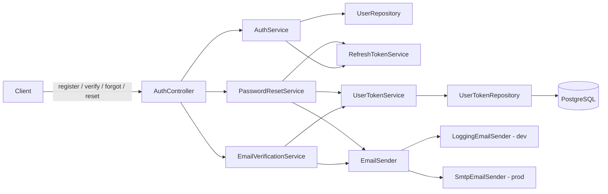
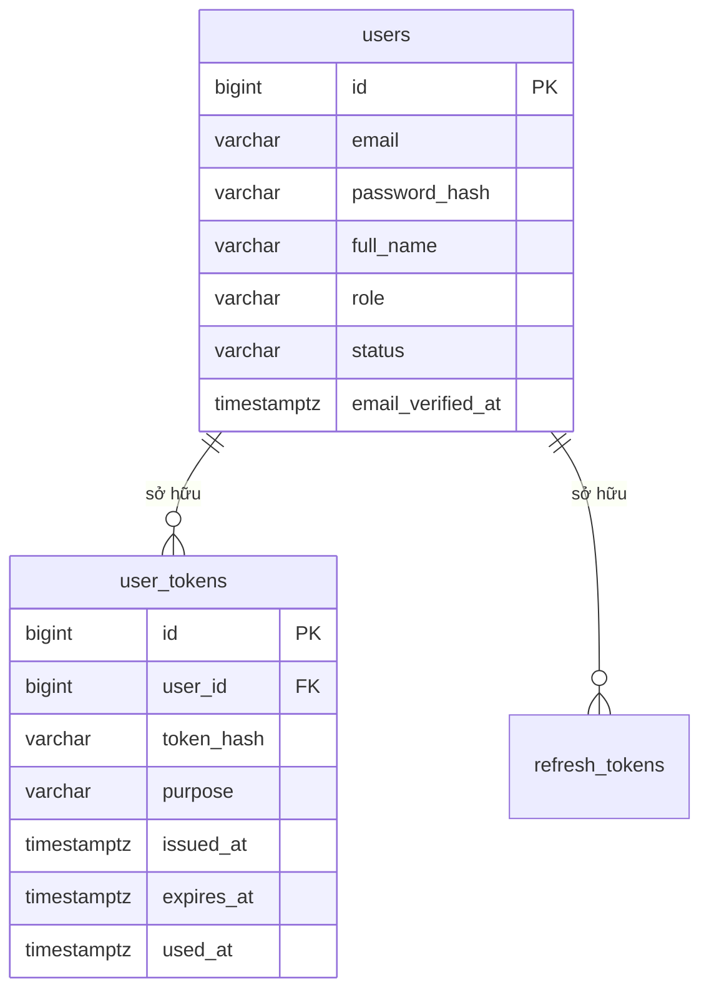
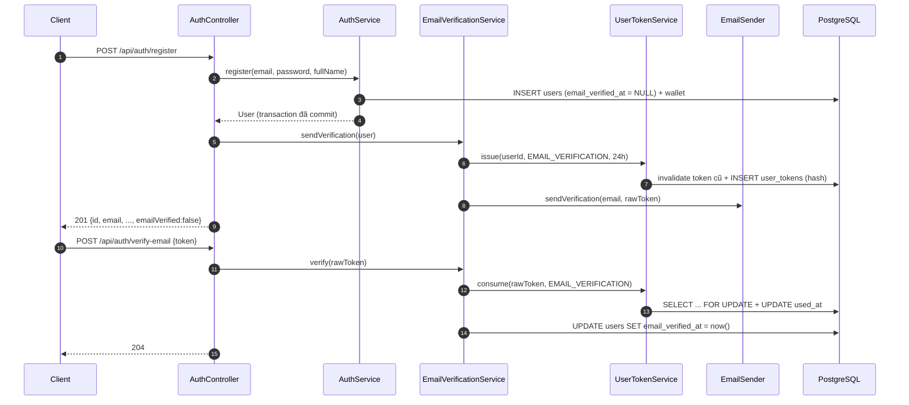
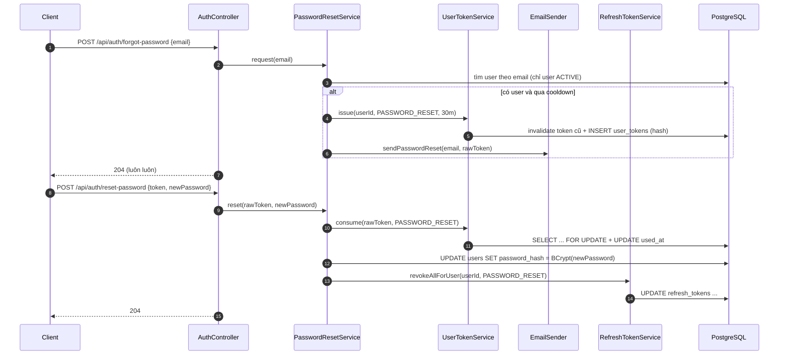
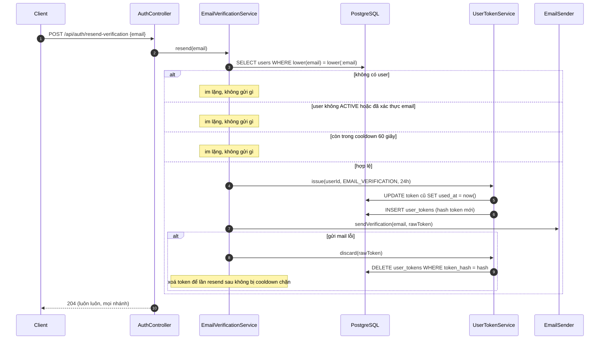
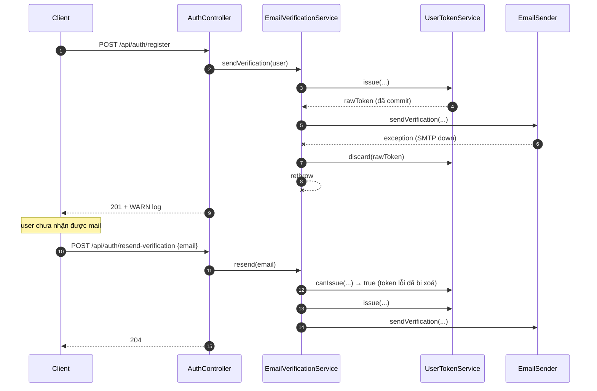
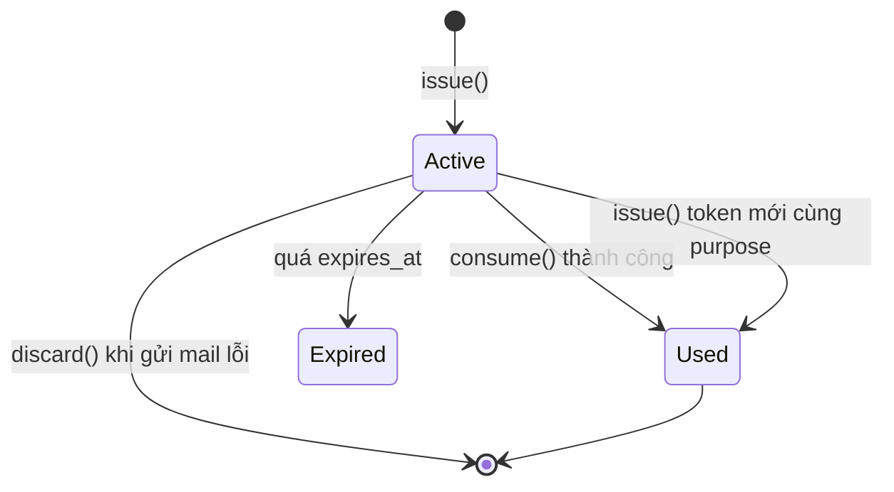
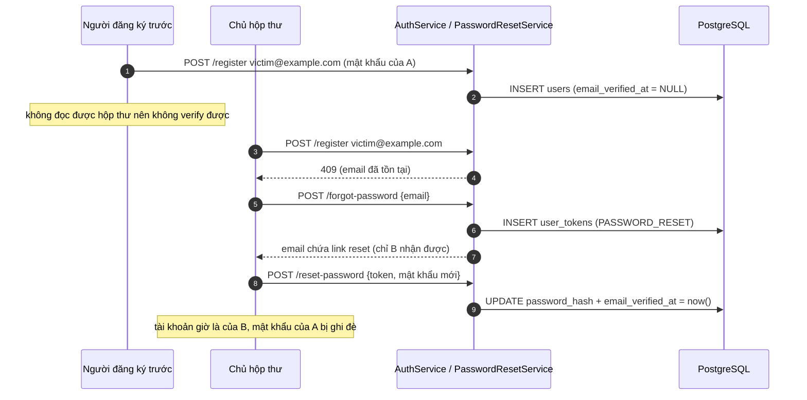

# Feature #5: Xác thực email + quên mật khẩu

Tài liệu kế hoạch. Không phải code cuối cùng. Mục tiêu là để tự làm từng bước,
hiểu vì sao làm vậy, và có tiêu chí rõ ràng để biết khi nào xong.

Điểm xuất phát: commit `eccb200` (feature #4), 264 test xanh, migration mới nhất
là `V10__refresh_tokens.sql`.

## 0. Mục tiêu

1. Đăng ký xong tài khoản ở trạng thái **chưa xác thực email**; phải bấm link
   trong email mới đăng nhập được.
2. Gửi lại email xác thực khi người dùng làm mất thư.
3. Quên mật khẩu: gửi link đặt lại mật khẩu, token dùng một lần, hết hạn sau
   30 phút.
4. Đặt lại mật khẩu xong phải **thu hồi mọi refresh token** của user.
5. Không tiết lộ email nào đã đăng ký qua các endpoint gửi mail.
6. Tách việc gửi email khỏi transaction; dev dùng logging sender, prod dùng SMTP.

## 1. Hiện trạng trong code

- `users` chưa có cột `email_verified_at`; đăng ký xong là đăng nhập được ngay.
- Chưa có thư viện mail trong `pom.xml`.
- `Notification` là thông báo **trong ứng dụng**, đi qua Kafka/outbox. Đây không
  phải email; không nên tái sử dụng cho mail.
- `RefreshTokenService` đã có cách sinh token 32 byte và hash SHA-256, nhưng đang
  là method private.
- `RefreshTokenRepository.revokeAllByUser(...)` đã có, dùng lại được.
- `RevokedReason` có 5 giá trị, chưa có lý do cho đặt lại mật khẩu.
- `RegisterRequest` đã có chính sách mật khẩu 8–72 ký tự và giới hạn 72 byte
  UTF-8 cho BCrypt.
- `ApiExceptionHandler` đã có mẫu 400/401/403/429.
- `SecurityConfig` đã `permitAll` cho `/api/auth/**`.
- Test dùng chung `AbstractPostgresIntegrationTest`; bốn test class đăng ký qua
  API rồi đăng nhập ngay sẽ phải cập nhật khi bật xác thực email.

## 2. Phạm vi

### Làm trong feature này

- Cột `users.email_verified_at` + backfill user cũ.
- Bảng `user_tokens` dùng chung cho xác thực email và đặt lại mật khẩu.
- Sinh, băm, dùng một lần, thu hồi token.
- `EmailSender` với hai triển khai: log ra console (dev/test) và SMTP (thật).
- Endpoint: `verify-email`, `resend-verification`, `forgot-password`,
  `reset-password`.
- Chặn đăng nhập khi email chưa xác thực.
- Thu hồi refresh token khi đổi mật khẩu.
- Cấu hình TTL, tài liệu, test.

### Không làm (để feature sau)

- Gửi email qua Kafka/outbox. Email là I/O ra ngoài, không phải domain event;
  đưa vào outbox sẽ phải thêm consumer và cơ chế retry riêng.
- Theo dõi bounce/complaint, retry gửi mail tự động.
- Template HTML đẹp, đa ngôn ngữ.
- Đăng nhập bằng magic link, xác thực số điện thoại.
- Denylist access token (vẫn là L7).
- Chuyển rate limiter sang Redis (vẫn là L7).
- Job dọn token hết hạn: tùy chọn, giống feature #4.

## 3. Quyết định thiết kế

| Vấn đề | Chọn | Lý do |
|---|---|---|
| Bảng token | **Một bảng `user_tokens` + cột `purpose`** | Hai loại token dùng chung hash, hạn, dùng một lần; tách bảng sẽ lặp code |
| Token gốc | **32 byte, Base64URL không padding** | Giống refresh token, 256 bit entropy |
| Lưu DB | **SHA-256 hex** | Lộ DB không lộ token; tra cứu được bằng unique index |
| TTL xác thực email | **24 giờ** | Đủ thời gian đọc mail, không sống quá lâu |
| TTL đặt lại mật khẩu | **30 phút** | Giảm cửa sổ tấn công nếu lộ hộp thư |
| Dùng một lần | **`used_at` + `SELECT ... FOR UPDATE`** | Hai request đồng thời không cùng tiêu thụ một token |
| Phát token mới | **Đánh dấu `used_at` cho token cũ cùng purpose** | Chỉ link mới nhất còn hiệu lực |
| Đăng nhập khi chưa xác thực | **403 sau khi mật khẩu đúng** | Chỉ lộ trạng thái cho người đã biết mật khẩu |
| Quên mật khẩu / gửi lại | **Luôn 204, body rỗng** | Không lộ email nào đã đăng ký |
| Đặt lại mật khẩu xong | **Thu hồi mọi refresh token, không auto-login** | Phiên cũ bị đá; user đăng nhập lại bằng mật khẩu mới |
| Gửi email | **Interface `EmailSender`, dev log, prod SMTP** | Test/dev không cần SMTP; đổi provider dễ |
| Thời điểm gửi | **Sau khi transaction commit** | Tránh gửi mail rồi DB rollback |
| Chống lạm dụng | **Cooldown 60 giây theo user**, tùy chọn giới hạn IP | Đủ cho một instance; ghi rõ giới hạn |
| Link trong mail | **Trỏ frontend, token ở query string** | API nhận token qua body, không dính CSRF |
| User cũ | **Backfill `email_verified_at = now()`** | Không khóa tài khoản đang dùng |

## 4. Sơ đồ

### 4.1 Thành phần



### 4.2 Mô hình dữ liệu



### 4.3 Đăng ký + xác thực email



### 4.4 Quên + đặt lại mật khẩu



### 4.5 Gửi lại email xác thực



Điểm quan trọng: nhánh "có user" và nhánh "không có user" **không khác nhau ở phản hồi**.
Nếu trả 404 cho email lạ thì kẻ tấn công dùng endpoint này để dò danh sách email đã đăng ký.

### 4.6 Khi gửi mail thất bại

`EmailSender` ném lỗi (SMTP timeout, sai cấu hình, mail bị chặn) trong hai tình huống:

1. **Ngay sau đăng ký** — bắt ở `AuthController.register`, log WARN, vẫn trả `201`.
   Token vừa tạo bị `discard()` nên DB không còn dòng rác.
2. **Trong resend** — bắt ở `AuthController.resendVerification`, vẫn trả `204`.

Cả hai trường hợp, user tự phục hồi bằng cách gọi lại `POST /api/auth/resend-verification`
với email của mình. Vì token lỗi đã bị xoá, cooldown không chặn lần gọi ngay sau đó.



Nếu mail vẫn tiếp tục lỗi, đó là lỗi hạ tầng chứ không phải lỗi nghiệp vụ:

- Dev: `nvest.mail.enabled=false`, link in ra log của `LoggingEmailSender`.
- Prod: kiểm tra `SPRING_MAIL_HOST/PORT/USERNAME/PASSWORD`, `NVEST_MAIL_FROM`,
  và bật `NVEST_MAIL_HEALTH_ENABLED=true` để `/actuator/health` phản ánh tình trạng SMTP.

### 4.7 Vòng đời một token



### 4.8 Email đã bị người khác đăng ký trước nhưng chưa xác thực

Kịch bản: người lạ đăng ký `victim@example.com` bằng mật khẩu của họ. Họ không đọc
được hộp thư nên không bao giờ xác thực được, nhưng dòng `users` đã tồn tại. Chủ
thật đăng ký lại → `409`.

**Quyết định: giữ 409, không cho đăng ký lại ghi đè.** Đường lấy lại là
`forgot-password`, vì link reset được gửi tới hộp thư — chỉ chủ thật bấm được.



**Vì sao không cho đăng ký lại ghi đè tài khoản chưa xác thực.** Nghe hợp lý, nhưng
tạo ra race:

1. Chủ thật đăng ký → nhận email xác thực.
2. Kẻ tấn công đăng ký cùng email ngay sau đó → mật khẩu bị ghi đè thành của kẻ
   tấn công, token cũ của chủ thật bị vô hiệu.
3. Chủ thật bấm link trong email (link cũ hoặc link mới đều do kẻ tấn công phát)
   → tài khoản được xác thực **với mật khẩu của kẻ tấn công**.

Gốc rễ: bất kỳ thiết kế nào cho phép người đăng ký đặt mật khẩu **trước khi** xác
thực đều có lỗ hổng này. Cách triệt để là đăng ký chỉ bằng email, mật khẩu đặt ở
bước xác thực — ngoài phạm vi feature này.

**Rủi ro còn lại (chấp nhận, có ghi tài liệu).** Kẻ tấn công đăng ký trước và hệ
thống gửi email "xác thực" tới chủ thật. Nếu chủ thật bấm link đó, tài khoản của kẻ
tấn công được kích hoạt. Giảm thiểu:

- Nội dung email nói rõ "Nếu bạn không đăng ký tài khoản, hãy bỏ qua email này."
- Tài khoản chưa xác thực không đăng nhập được (T6), nên kẻ tấn công chỉ thắng nếu
  có người bấm link.
- Frontend khi nhận `409` gợi ý dùng "Quên mật khẩu" thay vì đăng ký lại.

## 5. Thiết kế database (V11)

Tạo `src/main/resources/db/migration/V11__user_tokens.sql`. Không sửa V10.

```sql
-- V11: xác thực email và đặt lại mật khẩu.
ALTER TABLE users ADD COLUMN email_verified_at TIMESTAMPTZ;

-- User đang dùng không bị khóa sau khi bật xác thực email.
UPDATE users SET email_verified_at = now() WHERE email_verified_at IS NULL;

CREATE TABLE user_tokens (
    id         BIGINT GENERATED ALWAYS AS IDENTITY PRIMARY KEY,
    user_id    BIGINT      NOT NULL REFERENCES users (id) ON DELETE CASCADE,
    token_hash VARCHAR(64) NOT NULL,
    purpose    VARCHAR(30) NOT NULL,
    issued_at  TIMESTAMPTZ NOT NULL DEFAULT now(),
    expires_at TIMESTAMPTZ NOT NULL,
    used_at    TIMESTAMPTZ,
    CONSTRAINT ck_user_tokens_purpose CHECK (
        purpose IN ('EMAIL_VERIFICATION', 'PASSWORD_RESET')
    )
);

CREATE UNIQUE INDEX ux_user_tokens_hash ON user_tokens (token_hash);
CREATE INDEX ix_user_tokens_user_purpose ON user_tokens (user_id, purpose);
CREATE INDEX ix_user_tokens_expires ON user_tokens (expires_at);

-- Thêm lý do thu hồi refresh token khi đặt lại mật khẩu.
ALTER TABLE refresh_tokens DROP CONSTRAINT ck_refresh_tokens_reason;
ALTER TABLE refresh_tokens ADD CONSTRAINT ck_refresh_tokens_reason CHECK (
    revoked_reason IS NULL
    OR revoked_reason IN (
        'ROTATED', 'LOGOUT', 'LOGOUT_ALL', 'REUSE_DETECTED', 'USER_LOCKED',
        'PASSWORD_RESET'
    )
);
```

Lưu ý khi chạy local: nếu DB đã có V11 do thử nghiệm, phải xóa dòng version 11
trong `flyway_schema_history` và drop bảng/cột tương ứng trước khi chạy lại.

## 6. API contract

### 6.1 Register (đổi hành vi, không đổi mã trạng thái)

```http
POST /api/auth/register
Content-Type: application/json

{"email":"an@example.com","password":"S3cure-passw0rd","fullName":"Nguyen Van An"}
```

- `201`: user được tạo ở trạng thái **chưa xác thực**, email xác thực được gửi.
- Body trả thêm `"emailVerified": false` (thay đổi additive, không phá client cũ).
- Nếu gửi mail lỗi: vẫn `201`, log WARN; user dùng endpoint gửi lại.

### 6.2 Verify email

```http
POST /api/auth/verify-email
Content-Type: application/json

{"token":"3xJ..."}
```

- `204`: xác thực thành công.
- `400`: token thiếu, sai, đã dùng hoặc hết hạn. Cùng một thông báo chung.

### 6.3 Resend verification

```http
POST /api/auth/resend-verification
Content-Type: application/json

{"email":"an@example.com"}
```

- `204`: luôn luôn, kể cả email không tồn tại hoặc đã xác thực.
- `400`: email sai định dạng.
- Chưa có `429` theo IP (xem L10); cooldown 60 giây theo user vẫn trả `204`.

### 6.4 Login (thêm một nhánh lỗi)

```http
POST /api/auth/login
Content-Type: application/json

{"email":"an@example.com","password":"S3cure-passw0rd"}
```

- `200`: như feature #4.
- `401`: sai email/mật khẩu hoặc tài khoản bị khóa (giữ nguyên R63).
- `403`: mật khẩu đúng nhưng email chưa xác thực. Chỉ người biết mật khẩu mới
  thấy được nhánh này. Body problem+json có `"code":"EMAIL_NOT_VERIFIED"` để client
  phân biệt với 403 do thiếu quyền.

### 6.5 Forgot password

```http
POST /api/auth/forgot-password
Content-Type: application/json

{"email":"an@example.com"}
```

- `204`: luôn luôn, không tiết lộ email có tồn tại hay không.
- `400`: email sai định dạng.
- Chưa có `429` theo IP (xem L10); cooldown 60 giây theo user vẫn trả `204`.

### 6.6 Reset password

```http
POST /api/auth/reset-password
Content-Type: application/json

{"token":"3xJ...","newPassword":"N3w-passw0rd"}
```

- `204`: đổi mật khẩu thành công, mọi refresh token bị thu hồi.
- `400`: token sai/hết hạn/đã dùng, hoặc mật khẩu không đạt chính sách.
- Không trả token mới, không tự đăng nhập.

### 6.7 Mã lỗi

| Tình huống | Mã | Ghi chú |
|---|---|---|
| Token xác thực/đặt lại sai, hết hạn, đã dùng | 400 | Một thông báo chung |
| Email chưa xác thực (đúng mật khẩu) | 403 | `Email not verified` |
| Sai mật khẩu / user khóa | 401 | Giữ R63 |
| Gửi lại / quên mật khẩu thành công | 204 | Luôn 204 |
| Quá nhiều request | 429 | Nếu bật giới hạn IP |

## 7. Luồng xử lý chi tiết

### 7.1 Tách tiện ích token dùng chung

Hiện `RefreshTokenService` có `newRawToken()` và `hash()` private. Tách thành
`OpaqueTokens` để hai feature dùng chung, tránh copy-paste:

```java
package vn.nvest.savings.user;

import java.nio.charset.StandardCharsets;
import java.security.MessageDigest;
import java.security.NoSuchAlgorithmException;
import java.security.SecureRandom;
import java.util.Base64;
import java.util.HexFormat;

public final class OpaqueTokens {

    private static final SecureRandom SECURE_RANDOM = new SecureRandom();

    private OpaqueTokens() {
    }

    public static String newRawToken() {
        byte[] bytes = new byte[32];
        SECURE_RANDOM.nextBytes(bytes);
        return Base64.getUrlEncoder().withoutPadding().encodeToString(bytes);
    }

    public static String sha256Hex(String rawToken) {
        try {
            byte[] digest = MessageDigest.getInstance("SHA-256")
                    .digest(rawToken.getBytes(StandardCharsets.UTF_8));
            return HexFormat.of().formatHex(digest);
        } catch (NoSuchAlgorithmException e) {
            throw new IllegalStateException(e);
        }
    }
}
```

Sau đó `RefreshTokenService` gọi `OpaqueTokens.newRawToken()` và
`OpaqueTokens.sha256Hex(...)`. Test hiện tại của feature #4 vẫn phải xanh.

### 7.2 `UserTokenService`

```java
@Transactional
public String issue(long userId, UserTokenPurpose purpose, Duration ttl) {
    Instant now = clock.instant();
    repository.invalidateUnused(userId, purpose, now);

    String rawToken = OpaqueTokens.newRawToken();
    repository.save(UserToken.issue(
            userId, OpaqueTokens.sha256Hex(rawToken), purpose, now, now.plus(ttl)));
    return rawToken;
}

@Transactional
public Optional<UserToken> consume(String rawToken, UserTokenPurpose purpose) {
    Instant now = clock.instant();
    Optional<UserToken> found = repository.findByTokenHashForUpdate(
            OpaqueTokens.sha256Hex(rawToken));
    if (found.isEmpty()) {
        return Optional.empty();
    }
    UserToken token = found.get();
    if (token.getPurpose() != purpose || token.isUsed() || token.isExpired(now)) {
        return Optional.empty();
    }
    token.markUsed(now);
    return Optional.of(token);
}

@Transactional(readOnly = true)
public boolean canIssue(long userId, UserTokenPurpose purpose) {
    return repository.findTopByUserIdAndPurposeOrderByIdDesc(userId, purpose)
            .map(last -> !last.getIssuedAt().plus(properties.cooldown()).isAfter(clock.instant()))
            .orElse(true);
}
```

Repository:

```java
public interface UserTokenRepository extends JpaRepository<UserToken, Long> {

    @Lock(LockModeType.PESSIMISTIC_WRITE)
    @Query("select t from UserToken t where t.tokenHash = :sha256Hex")
    Optional<UserToken> findByTokenHashForUpdate(@Param("sha256Hex") String hash);

    Optional<UserToken> findTopByUserIdAndPurposeOrderByIdDesc(
            Long userId, UserTokenPurpose purpose);

    @Modifying(flushAutomatically = true, clearAutomatically = true)
    @Query("""
        update UserToken t
           set t.usedAt = :now
         where t.userId = :userId
           and t.purpose = :purpose
           and t.usedAt is null
        """)
    int invalidateUnused(@Param("userId") Long userId,
                         @Param("purpose") UserTokenPurpose purpose,
                         @Param("now") Instant now);
}
```

### 7.3 Gửi email

Interface:

```java
public interface EmailSender {
    void sendVerification(String to, String fullName, String rawToken);
    void sendPasswordReset(String to, String fullName, String rawToken);
}
```

Triển khai dev (mặc định):

```java
@Component
@ConditionalOnProperty(name = "nvest.mail.enabled", havingValue = "false",
        matchIfMissing = true)
public class LoggingEmailSender implements EmailSender {

    private static final Logger log = LoggerFactory.getLogger(LoggingEmailSender.class);

    private final MailProperties properties;

    @Override
    public void sendVerification(String to, String fullName, String rawToken) {
        log.info("Verification email for {} <{}>: {}{}",
                fullName, to, properties.verificationLink(), rawToken);
    }

    @Override
    public void sendPasswordReset(String to, String fullName, String rawToken) {
        log.info("Password reset email for {} <{}>: {}{}",
                fullName, to, properties.resetLink(), rawToken);
    }
}
```

Triển khai SMTP:

```java
@Component
@ConditionalOnProperty(name = "nvest.mail.enabled", havingValue = "true")
public class SmtpEmailSender implements EmailSender {

    private final JavaMailSender mailSender;
    private final MailProperties properties;

    private void send(String to, String subject, String body) {
        SimpleMailMessage message = new SimpleMailMessage();
        message.setFrom(properties.from());
        message.setTo(to);
        message.setSubject(subject);
        message.setText(body);
        mailSender.send(message);
    }
}
```

Thêm dependency:

```xml
<dependency>
    <groupId>org.springframework.boot</groupId>
    <artifactId>spring-boot-starter-mail</artifactId>
</dependency>
```

### 7.4 Đăng ký

`AuthController.register` gọi service, rồi gửi mail **sau khi transaction đã
commit**:

```java
@PostMapping("/register")
@ResponseStatus(HttpStatus.CREATED)
public UserProfile register(@Valid @RequestBody RegisterRequest request) {
    User user = authService.register(
            request.email(), request.password(), request.fullName());
    try {
        emailVerificationService.sendVerification(user);
    } catch (RuntimeException e) {
        // Không để lỗi gửi mail biến một đăng ký thành công thành 500.
        log.warn("Cannot send verification email for user {}", user.getId(), e);
    }
    return UserProfile.from(user);
}
```

`sendVerification` không nằm trong transaction đăng ký. Nó tự gọi
`userTokenService.issue(...)` (mở transaction riêng), rồi mới gửi mail. Nếu gửi
mail lỗi, token vẫn còn và user có thể gọi gửi lại.

### 7.5 Đăng nhập

```java
if (user.isEmpty() || !passwordMatches || user.get().getStatus() != UserStatus.ACTIVE) {
    throw new InvalidCredentialsException();
}
if (!user.get().isEmailVerified()) {
    throw new EmailNotVerifiedException();
}
return refreshTokenService.issue(user.get());
```

Thứ tự quan trọng: kiểm tra mật khẩu trước, rồi mới kiểm tra xác thực. Như vậy
người không biết mật khẩu chỉ thấy 401 chung, không dò được email đã đăng ký.

### 7.6 Quên mật khẩu

```java
public void request(String email) {
    userRepository.findByEmailIgnoreCase(email.trim())
            .filter(u -> u.getStatus() == UserStatus.ACTIVE)
            .ifPresent(user -> {
                if (!userTokenService.canIssue(user.getId(), PASSWORD_RESET)) {
                    return;
                }
                String rawToken = userTokenService.issue(
                        user.getId(), PASSWORD_RESET, properties.resetTtl());
                emailSender.sendPasswordReset(
                        user.getEmail(), user.getFullName(), rawToken);
            });
}
```

Không `throw` khi không tìm thấy email. Controller luôn trả 204.

### 7.7 Đặt lại mật khẩu

```java
@Transactional
public void reset(String rawToken, String newPassword) {
    UserToken token = userTokenService.consume(rawToken, PASSWORD_RESET)
            .orElseThrow(InvalidEmailTokenException::new);

    User user = userRepository.findById(token.getUserId())
            .filter(u -> u.getStatus() == UserStatus.ACTIVE)
            .orElseThrow(InvalidEmailTokenException::new);

    user.changePassword(passwordEncoder.encode(newPassword));
    userRepository.saveAndFlush(user);   // ghi mật khẩu trước

    refreshTokenService.revokeAllForUser(user.getId(), RevokedReason.PASSWORD_RESET);
}
```

`revokeAllForUser` thêm vào `RefreshTokenService`:

```java
@Transactional
public void revokeAllForUser(long userId, RevokedReason reason) {
    refreshTokenRepository.revokeAllByUser(userId, clock.instant(), reason);
}
```

Lưu ý: `revokeAllByUser` có `flushAutomatically = true, clearAutomatically = true`.
Vì vậy phải `saveAndFlush` mật khẩu **trước** khi gọi, để thay đổi mật khẩu
không bị mất khi persistence context bị clear.

### 7.8 Chống lạm dụng

- Cooldown theo user: `canIssue` dựa trên `issued_at` của token gần nhất.
  Mặc định 60 giây. Trong cooldown thì im lặng, vẫn trả 204.
- Giới hạn theo IP (tùy chọn, nên làm): một component in-memory giống
  `LoginRateLimiter`, khóa theo `purpose|IP`, ví dụ 5 request / 15 phút, trả 429.
  Ghi rõ đây là giới hạn một instance (L10).
- Không dùng chung `LoginRateLimiter` vì nó đếm "lần đăng nhập thất bại", không
  phải "số request gửi mail".

## 8. Danh sách task

Làm theo thứ tự. Mỗi task nên chạy được test trước khi sang task sau.

### T1. Migration + entity + repository

**File**

- `src/main/resources/db/migration/V11__user_tokens.sql`
- `src/main/java/vn/nvest/savings/user/User.java`
- `src/main/java/vn/nvest/savings/user/UserToken.java`
- `src/main/java/vn/nvest/savings/user/UserTokenPurpose.java`
- `src/main/java/vn/nvest/savings/user/UserTokenRepository.java`
- `src/main/java/vn/nvest/savings/user/RevokedReason.java`

**Việc cần làm**

- Chạy SQL ở mục 5.
- `User` thêm `emailVerifiedAt`, `markEmailVerified(Instant)`, `isEmailVerified()`,
  `changePassword(String hash)`.
- `UserToken` map đúng cột, `issue(...)`, `isUsed()`, `isExpired(Instant)`,
  `markUsed(Instant)`.
- `UserTokenPurpose` gồm `EMAIL_VERIFICATION`, `PASSWORD_RESET`.
- Repository có `findByTokenHashForUpdate` (PESSIMISTIC_WRITE),
  `findTopByUserIdAndPurposeOrderByIdDesc`, `invalidateUnused`.
- `RevokedReason` thêm `PASSWORD_RESET`.

**Xong khi**

- App khởi động được với `ddl-auto=validate`.
- `mvn -B -ntp -Dtest=AuthIntegrationTest#loginReturnsABearerToken test` xanh.
- User cũ trong DB local có `email_verified_at` khác NULL.

### T2. Tách `OpaqueTokens` + refactor refresh token

**File**

- `src/main/java/vn/nvest/savings/user/OpaqueTokens.java`
- `src/main/java/vn/nvest/savings/user/RefreshTokenService.java`

**Việc cần làm**

- Thêm `OpaqueTokens` như mục 7.1.
- `RefreshTokenService` dùng lại, xóa `newRawToken`/`hash` private.
- Không đổi hành vi, không đổi API.

**Xong khi**

- `mvn -B -ntp -Dtest=RefreshTokenServiceIntegrationTest,RefreshTokenApiIntegrationTest,LogoutApiIntegrationTest test` xanh.

### T3. `UserTokenService`

**File**

- `src/main/java/vn/nvest/savings/user/UserTokenService.java`
- `src/main/java/vn/nvest/savings/user/EmailTokenProperties.java`
- `src/main/java/vn/nvest/savings/user/SecurityConfig.java`

**Việc cần làm**

- Thêm `EmailTokenProperties` với `verificationTtl` (PT24H), `resetTtl` (PT30M),
  `cooldown` (PT60S), có validate và giá trị mặc định như
  `RefreshTokenProperties`.
- Đăng ký properties trong `@EnableConfigurationProperties`.
- Cài `issue`, `consume`, `canIssue` như mục 7.2.
- Unit test: token sinh ra dài 43 ký tự, hash 64 ký tự hex, consume lần hai trả
  rỗng, token hết hạn trả rỗng, token sai purpose trả rỗng.

**Xong khi**

- Test service xanh, chưa cần controller.

### T4. Gửi email

**File**

- `pom.xml`
- `src/main/java/vn/nvest/savings/user/EmailSender.java`
- `src/main/java/vn/nvest/savings/user/LoggingEmailSender.java`
- `src/main/java/vn/nvest/savings/user/SmtpEmailSender.java`
- `src/main/java/vn/nvest/savings/user/MailProperties.java`
- `src/main/resources/application.yml`

**Việc cần làm**

- Thêm `spring-boot-starter-mail`.
- `MailProperties`: `from`, `verificationLink`, `resetLink`.
- Hai implementation theo `nvest.mail.enabled`.
- Cấu hình:
  ```yaml
  spring:
    mail:
      host: ${SPRING_MAIL_HOST:localhost}
      port: ${SPRING_MAIL_PORT:1025}
      username: ${SPRING_MAIL_USERNAME:}
      password: ${SPRING_MAIL_PASSWORD:}
  nvest:
    mail:
      enabled: ${NVEST_MAIL_ENABLED:false}
      from: ${NVEST_MAIL_FROM:no-reply@nvest.local}
      verification-link: ${NVEST_VERIFICATION_LINK:http://localhost:3000/verify-email?token=}
      reset-link: ${NVEST_RESET_LINK:http://localhost:3000/reset-password?token=}
    auth:
      email-token:
        verification-ttl: ${NVEST_EMAIL_VERIFICATION_TTL:PT24H}
        reset-ttl: ${NVEST_PASSWORD_RESET_TTL:PT30M}
        cooldown: ${NVEST_EMAIL_TOKEN_COOLDOWN:PT60S}
  ```
- Test dùng một `EmailSender` giả để bắt nội dung, không gọi SMTP thật.

**Xong khi**

- Chạy app với `nvest.mail.enabled=false` thấy link trong log.
- Không có bean `JavaMailSender` nào bị tạo khi tắt mail.

### T5. Đăng ký + xác thực email

**File**

- `AuthController.java`
- `EmailVerificationService.java`
- `UserProfile.java`
- `common/InvalidEmailTokenException.java`
- `common/ApiExceptionHandler.java`
- `VerifyEmailRequest.java`
- `ResendVerificationRequest.java`

**Việc cần làm**

- `UserProfile` thêm `boolean emailVerified` (additive).
- `EmailVerificationService.sendVerification(User)`, `verify(rawToken)`, `resend(email)`.
- Controller: `POST /api/auth/verify-email` (204),
  `POST /api/auth/resend-verification` (204).
- `InvalidEmailTokenException` → 400 với thông báo chung
  "Invalid or expired token".
- Gửi mail sau khi đăng ký commit, bọc try/catch; nếu gửi lỗi thì
  `UserTokenService.discard(rawToken)` để không giữ lại token vô dụng và không
  chặn lần resend kế tiếp bằng cooldown.
- `resend(email)` chỉ gửi khi: user tồn tại, `ACTIVE`, chưa xác thực, và đã qua cooldown.

**Xong khi**

- Đăng ký xong DB có 1 dòng `user_tokens` purpose `EMAIL_VERIFICATION`.
- Verify đúng → `email_verified_at` khác NULL, token có `used_at`.
- Verify lại token đó → 400.
- Resend với email lạ → 204, không tạo dòng nào.
- Resend khi đã xác thực → 204, không gửi mail.
- Gửi mail lỗi lúc đăng ký → vẫn 201, `user_tokens` không còn dòng nào.

### T6. Chặn đăng nhập khi chưa xác thực

**File**

- `AuthService.java`
- `common/EmailNotVerifiedException.java`
- `common/ApiExceptionHandler.java`
- Các test helper.

**Việc cần làm**

- Sau khi mật khẩu đúng, kiểm tra `isEmailVerified()`, nếu chưa thì ném
  `EmailNotVerifiedException` → 403.
- Cập nhật test cũ để user đã xác thực:
  - `AbstractPostgresIntegrationTest.createUserWithDeposit`: INSERT thêm
    `email_verified_at = now()`.
  - `AuthIntegrationTest.registerAndGetId`: UPDATE user vừa tạo thành đã xác thực.
  - `RefreshTokenApiIntegrationTest.register`, `LogoutApiIntegrationTest.register`,
    `LoginRateLimitIntegrationTest.register`: làm tương tự.
- Test mới: đăng ký → login đúng mật khẩu → 403; sai mật khẩu → 401 (không lộ).

**Xong khi**

- Toàn bộ test cũ xanh.
- Test 403/401 phân biệt đúng.

### T7. Quên + đặt lại mật khẩu

**File**

- `PasswordResetService.java`
- `ForgotPasswordRequest.java`
- `ResetPasswordRequest.java`
- `AuthController.java`
- `RefreshTokenService.java`
- `User.java`

**Việc cần làm**

- `POST /api/auth/forgot-password` → 204 luôn.
- `POST /api/auth/reset-password` → 204; đổi mật khẩu, thu hồi refresh token.
- `ResetPasswordRequest` dùng chung chính sách mật khẩu với `RegisterRequest`
  (8–72 ký tự, ≤72 byte UTF-8).
- `User.changePassword(String hash)`.
- `RefreshTokenService.revokeAllForUser(userId, PASSWORD_RESET)`.
- Không auto-login sau reset.
- `forgot-password` **không** lọc theo `isEmailVerified`: nếu lọc, người bị
  đăng ký trước mất đường lấy lại tài khoản (mục 4.8).
- Reset thành công cũng set `email_verified_at = now()` nếu còn `NULL` (R81),
  cùng transaction với `changePassword` và `consume`.

**Xong khi**

- Reset xong: mật khẩu cũ 401, mật khẩu mới 200.
- Refresh token cũ 401, lý do `PASSWORD_RESET`.
- Dùng lại link reset → 400.
- Email lạ ở forgot → 204, không tạo token.
- Tài khoản chưa xác thực: reset xong login được ngay, không cần verify riêng.

### T8. Chống lạm dụng + trường hợp biên

**Việc cần làm**

- Cooldown 60 giây: gửi lại/quên mật khẩu trong cooldown vẫn 204 nhưng không gửi
  mail mới (đã dùng `UserTokenService.canIssue`).
- Chưa làm giới hạn theo IP (ghi ở L10): cần khi có người dùng thật, hoặc khi
  chạy nhiều instance thì phải chuyển sang Redis.
- Test: token hết hạn, token đã dùng, token sai purpose, user bị khóa, user bị xóa,
  body thiếu field, JSON hỏng, mật khẩu quá ngắn, mật khẩu quá 72 byte.

**Xong khi**

- Các test biên xanh.
- Không có thông báo nào khác nhau giữa email tồn tại và không tồn tại.

### T9. Cấu hình, tài liệu, README

**File**

- `.env.example`
- `docs/business-rules.md`
- `README.md`

**Việc cần làm**

- `.env.example`: thêm các biến mail và TTL.
- `docs/business-rules.md`: thêm R75–R81, cập nhật bảng tra cứu, thêm L10.
- `README.md`: mục "Xác thực email và quên mật khẩu" với curl.
- Ghi rõ: dev dùng logging sender; prod cần SMTP (Render chặn port 25, dùng 587).

**Xong khi**

- Tài liệu khớp hành vi thật, curl chạy được.

### T10. Job dọn `user_tokens`

- `UserTokenCleanupJob` chạy mỗi ngày lúc 03:30 (giờ Việt Nam), xóa token có
  `expires_at < now() - 30 ngày`.
- `nvest.jobs.user-token-cleanup.cron` (mặc định `0 30 3 * * *`) chỉnh được lịch;
  tôn trọng `nvest.scheduling.enabled` nhờ `SchedulingConfig`.
- Token hết hạn vốn không dùng được, nên job này chỉ để bảng không phình mãi.

## 9. Ma trận test

| # | Tên test | Loại | Kỳ vọng |
|---|---|---|---|
| 1 | `registerCreatesUnverifiedUserAndSendsEmail` | HTTP | 201, `emailVerified=false`, 1 token, email bắt được |
| 2 | `registerStillSucceedsAndDiscardsTokenWhenEmailFails` | HTTP | Sender ném lỗi → vẫn 201, token bị xoá, resend ngay được |
| 3 | `verifyMarksEmailVerifiedAndConsumesToken` | HTTP | 204, `email_verified_at` có, token `used_at` có |
| 4 | `verifyWithUnknownTokenReturns400` | HTTP | 400, thông báo chung |
| 5 | `verifyTwiceReturns400` | HTTP | 400 |
| 6 | `verifyEmailWithExpiredToken` | HTTP | 400 |
| 7 | `verifyRejectsTokenOfAnotherPurpose` | HTTP | 400, token `PASSWORD_RESET` không bị đánh dấu dùng |
| 8 | `loginBeforeVerification` | HTTP | 403 |
| 9 | `wrongPasswordBeforeVerification` | HTTP | 401, không lộ trạng thái |
| 10 | `resendForUnknownEmailDoesNothing` | HTTP | Email lạ → 204, không token mới |
| 11 | `resendAfterCooldownIssuesFreshTokenAndInvalidatesOld` | HTTP | Token cũ 400, token mới 204 |
| 12 | `resendWithinCooldownIsSilentlyIgnored` | HTTP | 204, không có email thứ hai |
| 12b | `resendForVerifiedUserDoesNothing` | HTTP | 204, không gửi mail |
| 13 | `forgotForUnknownEmailDoesNothing` | HTTP | Email lạ → 204, không token |
| 14 | `forgotCreatesResetTokenAndSendsEmail` | HTTP | 1 token `PASSWORD_RESET`, TTL 30 phút, email bắt được |
| 15 | `resetChangesPasswordAndRevokesSessions` | HTTP | 204, mật khẩu cũ 401 / mới 200, refresh token cũ 401, lý do `PASSWORD_RESET` |
| 16 | `resetDoesNotAutoLogin` | HTTP | 204, body rỗng |
| 17 | `resetIsSingleUse` | HTTP | Dùng lại token → 400, mật khẩu không đổi lần hai |
| 18 | `resetRejectsExpiredToken` | HTTP | 400 |
| 19 | `resetRejectsTokenOfAnotherPurpose` | HTTP | 400, token `EMAIL_VERIFICATION` không bị đánh dấu dùng |
| 20 | `resetWithUnknownTokenReturns400` | HTTP | 400, thông báo chung |
| 21 | `resetEnforcesPasswordPolicy` | HTTP | Ngắn / quá 72 byte → 400, token vẫn dùng được |
| 22 | `malformedRequestsReturn400` | HTTP | Thiếu field, email sai, token rỗng, JSON hỏng → 400 |
| 23 | `forgotWithinCooldownIsSilentlyIgnored` | HTTP | 204, chỉ 1 token và 1 mail |
| 24 | `forgotForLockedUserDoesNothing` | HTTP | 204, không gửi mail |
| 25 | `mailFailureKeeps204AndAllowsImmediateRetry` | HTTP | 204, token bị xoá, gửi lại ngay được |
| 26 | `resetClaimsUnverifiedAccount` | HTTP | Bị người khác đăng ký trước: forgot → reset → login được, `email_verified_at` có |
| 27 | `issueStoresHashPurposeAndTtl`, `consumeMarksTokenUsed`, `consumeRejectsSecondAttempt` | DB | Hash SHA-256, đúng purpose/TTL, dùng một lần |
| 28 | `consumeRejectsWrongPurposeWithoutMarkingUsed`, `consumeRejectsExpiredToken`, `consumeRejectsUnknownToken` | DB | Trả rỗng, không đánh dấu dùng |
| 29 | `canIssueRespectsCooldown` | DB | Trong cooldown `false`, sau cooldown `true` |
| 30 | `cleanupDeletesOnlyLongExpiredTokens` | DB | Xoá token hết hạn quá 30 ngày, giữ token còn hạn |

Không có test rate limit theo IP vì tính năng này chưa làm (xem L10).

## 10. Cập nhật business rules

Thêm vào mục M (sau R74), số tiếp theo là **R75**:

| Mã | Quy tắc |
|---|---|
| **R75** | Đăng ký tạo tài khoản chưa xác thực email. Link xác thực sống 24 giờ, dùng một lần; server chỉ lưu hash SHA-256 của token. |
| **R76** | Chỉ đăng nhập được khi email đã xác thực. Kiểm tra sau khi mật khẩu đúng; trả 403. Sai mật khẩu vẫn trả 401 chung như R63. |
| **R77** | Gửi lại xác thực và quên mật khẩu luôn trả 204, không tiết lộ email có tồn tại hay không. Cooldown 60 giây cho mỗi user. |
| **R78** | Link đặt lại mật khẩu sống 30 phút, dùng một lần. Đổi mật khẩu thu hồi mọi refresh token với lý do `PASSWORD_RESET`. |
| **R79** | Link trong email chứa token gốc; database chỉ lưu hash. Không log token gốc ở môi trường thật. |
| **R80** | Đặt lại mật khẩu không tự đăng nhập; user phải đăng nhập lại bằng mật khẩu mới. |
| **R81** | Đặt lại mật khẩu thành công chứng minh quyền kiểm soát hộp thư, nên cũng đánh dấu email đã xác thực. Đây là đường lấy lại tài khoản khi email đã bị người khác đăng ký trước nhưng chưa xác thực. |

Cập nhật bảng tra cứu: `R61–R64, R72–R81`.

Thêm **L10**:

| Mã | Giới hạn | Khi nào xử lý |
|---|---|---|
| **L10** | Email gửi đồng bộ sau khi commit, không retry tự động, không theo dõi bounce/complaint. Chỉ có cooldown theo user (60 giây); **chưa** giới hạn theo IP nên một IP có thể gửi mail cho nhiều email khác nhau. Nhà cung cấp SMTP free có hạn mức và có thể chặn. | Khi có người dùng thật: dùng outbox/queue cho email, thêm retry và theo dõi bounce, giới hạn theo IP (hoặc chuyển sang Redis nếu chạy nhiều instance). |

## 11. Cạm bẫy

1. **Gửi mail trong transaction.** Mail đã gửi rồi DB rollback → user nhận link
   vô hiệu. Luôn gửi sau commit.
2. **Quên backfill `email_verified_at`.** Toàn bộ user cũ bị 403 ngay sau deploy.
3. **Quên drop/recreate CHECK `ck_refresh_tokens_reason`.** Insert
   `PASSWORD_RESET` sẽ vi phạm constraint.
4. **Dùng `findByTokenHash` thường khi consume.** Hai request đồng thời có thể
   cùng dùng một token. Phải `PESSIMISTIC_WRITE`.
5. **`clearAutomatically` của bulk update.** `revokeAllByUser` clear persistence
   context; phải flush mật khẩu trước (`saveAndFlush`).
6. **Trả lỗi khác nhau cho email tồn tại/không tồn tại.** Lộ danh sách email.
7. **Log raw token ở prod.** Chỉ logging sender ở dev được log link.
8. **Tự gọi method `@Transactional` trong cùng class.** Proxy không kích hoạt;
   tách service hoặc gọi qua bean khác.
9. **Test gọi SMTP thật.** Luôn dùng `EmailSender` giả trong test.
10. **Link thiếu scheme hoặc sai base URL.** Client không mở được; cấu hình rõ
    `NVEST_VERIFICATION_LINK` và `NVEST_RESET_LINK`.
11. **BCrypt chỉ đọc 72 byte.** Dùng lại kiểm tra byte của `RegisterRequest`.
12. **Bật `nvest.mail.enabled=true` mà thiếu `spring.mail.host`.** App fail lúc
    khởi động; kiểm tra log.
13. **Cho đăng ký lại ghi đè tài khoản chưa xác thực.** Nghe tiện nhưng tạo race:
    kẻ tấn công chen vào giữa lúc chủ thật đăng ký và lúc bấm link sẽ đổi mật
    khẩu; chủ thật bấm link "xác thực" là kích hoạt tài khoản với mật khẩu của kẻ
    tấn công. Giữ 409 và lấy lại bằng `forgot-password` (mục 4.8).
14. **Lọc `isEmailVerified` trong `forgot-password`.** Sẽ khoá luôn đường lấy lại
    tài khoản bị đăng ký trước, vì tài khoản đó đúng là chưa xác thực.

## 12. Thứ tự commit đề xuất

1. `feat(auth): add user token schema and email verification state`
2. `refactor(auth): share opaque token generation`
3. `feat(auth): add user token service and email sender`
4. `feat(auth): require verified email for login`
5. `feat(auth): add password reset flow`
6. `feat(auth): guard email endpoints against abuse`
7. `docs(auth): document email verification and password reset`

## 13. Definition of Done

- [ ] `mvn -B -ntp verify` xanh, không giảm số test hiện có.
- [x] Đăng ký → nhận link (log hoặc SMTP) → verify → login được.
- [x] Login trước verify → 403; sai mật khẩu → 401.
- [x] Forgot → reset → mật khẩu mới dùng được, mật khẩu cũ và refresh token cũ
      đều bị từ chối.
- [x] Token trong DB là hash, không có raw token.
- [x] `forgot-password` và `resend-verification` không tiết lộ email có tồn tại
      (`register` vẫn trả 409 theo R61, đây là chấp nhận có chủ ý).
- [x] Email bị người khác đăng ký trước (chưa xác thực): forgot → reset → login được.
- [x] `docs/business-rules.md` có R75–R81 và L10.
- [x] README có ví dụ curl đầy đủ.
- [x] Không sửa file migration cũ.

## 14. Kiểm tra tay

```bash
# 1. Đăng ký
curl -i -X POST http://localhost:8080/api/auth/register \
  -H 'Content-Type: application/json' \
  -d '{"email":"an@example.com","password":"S3cure-passw0rd","fullName":"Nguyen Van An"}'

# 2. Đọc log để lấy link xác thực (dev), hoặc mở Mailpit
#    Verification email for ...: http://localhost:3000/verify-email?token=...

# 3. Xác thực
curl -i -X POST http://localhost:8080/api/auth/verify-email \
  -H 'Content-Type: application/json' \
  -d '{"token":"<token>"}'

# 4. Đăng nhập
curl -s -X POST http://localhost:8080/api/auth/login \
  -H 'Content-Type: application/json' \
  -d '{"email":"an@example.com","password":"S3cure-passw0rd"}'

# 5. Quên mật khẩu
curl -i -X POST http://localhost:8080/api/auth/forgot-password \
  -H 'Content-Type: application/json' \
  -d '{"email":"an@example.com"}'

# 6. Đặt lại mật khẩu
curl -i -X POST http://localhost:8080/api/auth/reset-password \
  -H 'Content-Type: application/json' \
  -d '{"token":"<token>","newPassword":"N3w-passw0rd"}'

# 7. Kiểm tra: mật khẩu cũ 401, mật khẩu mới 200,
#    refresh token cũ 401
```

## 15. Câu hỏi cần chốt trước khi code

1. **Có bắt buộc xác thực email không?** Đề xuất: có, kèm backfill user cũ.
   Nếu muốn demo nhanh mà không cần mail, có thể thêm cờ
   `nvest.auth.require-email-verification` mặc định `true`, nhưng sẽ phải test
   thêm một nhánh.
2. **Link trong mail trỏ frontend hay trỏ thẳng API?** Đề xuất: frontend
   (`/verify-email?token=...`, `/reset-password?token=...`), API nhận token qua
   body. Nếu chưa có frontend, có thể tạm trỏ thẳng API bằng GET, nhưng GET có
   side effect là đi ngược HTTP semantics.
3. **Nhà cung cấp SMTP khi deploy?** Chưa cần bây giờ (deploy đang hoãn). Khi
   làm: Render chặn port 25, dùng 587 với Brevo/Resend/Mailgun free tier.
4. **Có giới hạn theo IP ngay không?** Đề xuất: có, in-memory, 5 request / 15
   phút; ghi rõ là giới hạn một instance.
5. **Có thêm `emailVerified` vào `UserProfile` không?** Đề xuất: có, để frontend
   hiển thị banner "kiểm tra email". Đây là thay đổi additive.
